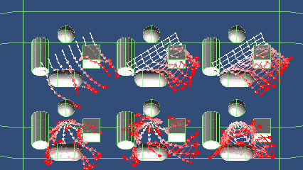
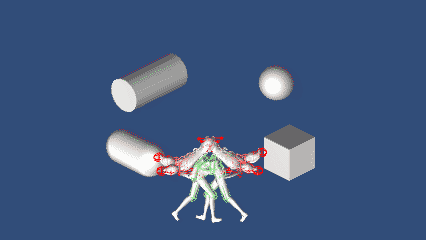
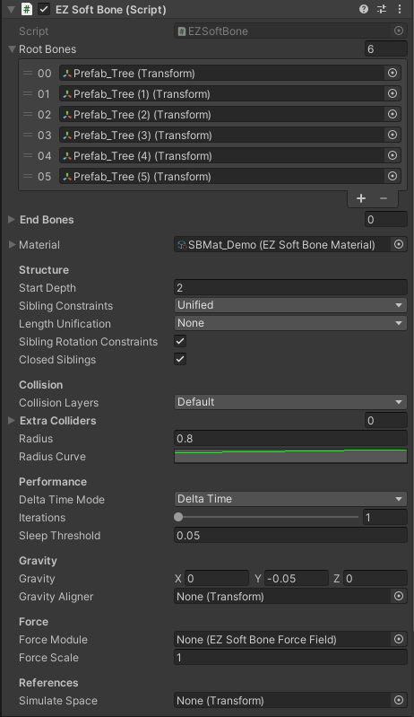
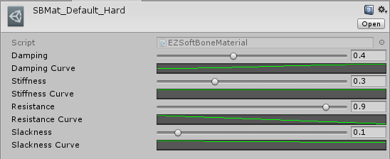
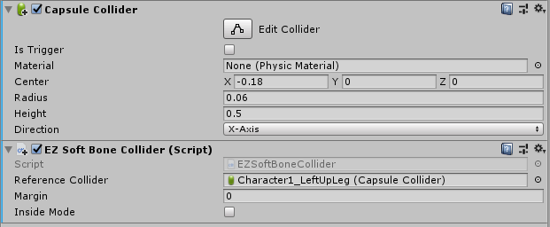
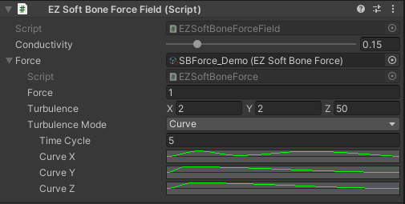
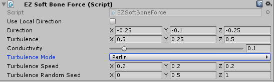

# EZSoftBone

[查看中文介绍](README_CN.md)  
[View it on GitHub](https://github.com/EZhex1991/EZSoftBone)  

EZSoftBone is a simple kinematic simulator for Unity, designed to simulate soft objects such as hair, tail, breast, skirt and more.

If you find it helpful, you may purchase it on AssetStore  
- [AssetStore](https://assetstore.unity.com/packages/slug/148136)  
- [AssetStoreChina](https://assetstore.u3d.cn/packages/tools/physics/assetstore-package-20007189)

[Donations](.SamplePicture/Donate.jpg) are also always welcome.

Should you need a refund, send your Invoice Number to ezhex1991@outlook.com. **Refunds are accepted for any reason**.

Tutorial Videos: 
- [Youtube](https://www.youtube.com/playlist?list=PLQq-xGF_CK-c5uPueOy_U7k3S5MIB32KJ)
- [BiliBili](https://space.bilibili.com/57392896/favlist?fid=1267164296&ftype=create)

- Support all collider types (including MeshCollider)
- Support mesh-like structures (cloth-style simulation)
- Adjust simulation behaviour via `EZSoftBoneMaterial`, reusable across multiple `EZSoftBone` instances
- Create custom colliders by inheriting from `EZSoftBoneColliderBase`
- Wind-simulation component: `EZSoftBoneForce`

## EZSoftBone

- Root Bones: List of root bone Transforms.
- End Bones: List of end bone Transforms. (used when parts of your soft-bone hierachy require different parameter settings)
- Material: `EZSoftBoneMaterial`, assigned simulation material. If none is assigned, the default material will be used at runtime.
- Structure
  - Start Depth: Hierachy depth at which simulation begins to take effect.
  - Sibling Constraints: Constraints applied between nodes sharing the same hierarchy depth.
    - None: No sibling constraints. (Chain simulation)
    - Rooted: Constrain nodes of equal depth under the same root bone. (Each root bone forms an independent mesh network)
    - Unified: Constrain equal-depth nodes across the whole system. (All RootBones together form one single mesh network)
  - Length Unification: Calculation rule for total bone-chain length; parameter distribution depends on this value.
    - None: Calculate each bone chain independently. (Use the longest child-chain length at branching points)
    - Rooted: Each root bone uses the longest child-chain length beneath itself.
    - Unified: Use the longest child-chain length found in the entire system.
  - Sibling Rotation Constraints: Whether sibling constraints also drive node rotation.
  - Closed Siblings: Enable closed-loop circular constraints.
- Collision
  - Collision Layers: Layers that participate in collision checks.
  - Extra Colliders: Lets ordinary Unity colliders participate in simulation. Originally added for legacy-code compatibility, kept due to pratical use-cases.
  - Radius: Radius of bone collision spheres.
  - Radius Curve: Distribution profile for collision-sphere radius.
- Gravity
  - Gravity: Gravity magnitude applied to this bone system.
  - Gravity Aligner: Assign a Transform as gravity reference frame. Effective gravity strength is inversely correlated with the dot-product between the aligner's Y-axis and world-space Y-axis.
    - *eg: Create a GameObject with zero world-space rotation, parent it under the character's head, and assign it as the hair-system Gravity Aligner. You will see the Grivity barely affects hair while the character stands upright, and gravity effect increases when the character lies down or bows their head.*
    - For a heady context-menu to reset a Transform's world rotation, refer to: [EZTransformContextMenu](https://github.com/EZhex1991/EZUnity/blob/master/Assets/EZhex1991/EZUnity/Editor/ContextMenu/EZTransformContextMenu.cs)
- Force
  - Force Module: `EZSoftBoneForce`, external force module applied to bones. (Can be used for wind simulation)
  - Force Scale: Global scale multiplier for Force Module output.
- References
  - Simulate Space: Assign a Transform as reference frame for simulation calculations. Use this when soft bones need to move together with an object and stay relatively static.
    - *eg: For a character sitting inside a moving vehicle, hair should remain relatively static against the vehicle.*
- Performance **(Implementation Incomplete)**
  - Delta Time Mode
    - Delta Time: `UnityEngine.Time.deltaTime`.
    - Unscaled Delta Time: `UnityEngine.Time.unscaledDeltaTime`.
    - Constant: User-defined fixed time-step value.
  - Sleep Threshold: Nodes with velocity below this value are considered stationary. Adjust this value at high frame-rates to suppress abnormal jitter.

## EZSoftBoneMaterial

Assets/Create/EZSoftBone/SBMat

- Damping: Higher values produce faster velocity decay, making motion appare move "floaty".
- Stiffness: Higher values presever original shape better, making the structure feel stiffer.
- Resistance: External-force resistance. Higher values reduce influence from Gravity and Force-Module.
- Slackness: Higher values allow bone-chain length to change more easily, making chains easier to stretch.

Each parameter have an associated Curve, defining how values distribute across the bone hierarchy.

## EZSoftBoneCollider

- Reference Collider: All type of Unity Collider can be referenced, **An EZSoftBoneCollider does not need to reside on the same GameObject as its reference collider.**
- Margin: Collision margin
- Inside Mode: Inside-collsion behaviour setting

## EZSoftBoneForce

Assets/Create/EZSoftBone/SBForce

- Conductivity: Force conductivity.
- Force: Base force magnitude. (applied along local Z-axis)
- Turbulence: Turbulence vector magnitude.
- Turbulence Mode:
  - Curve: Suitable for explosion-style effects.
    - Turbulence Time Cycle: Time cycle for curve-driven turbulence.
    - Turbulence Curve: Turbulence variation curve for each axis.
  - Perlin: Suitable for natural-wind simulation
    - Frequency: Turbulence noise frequency for each axis.
